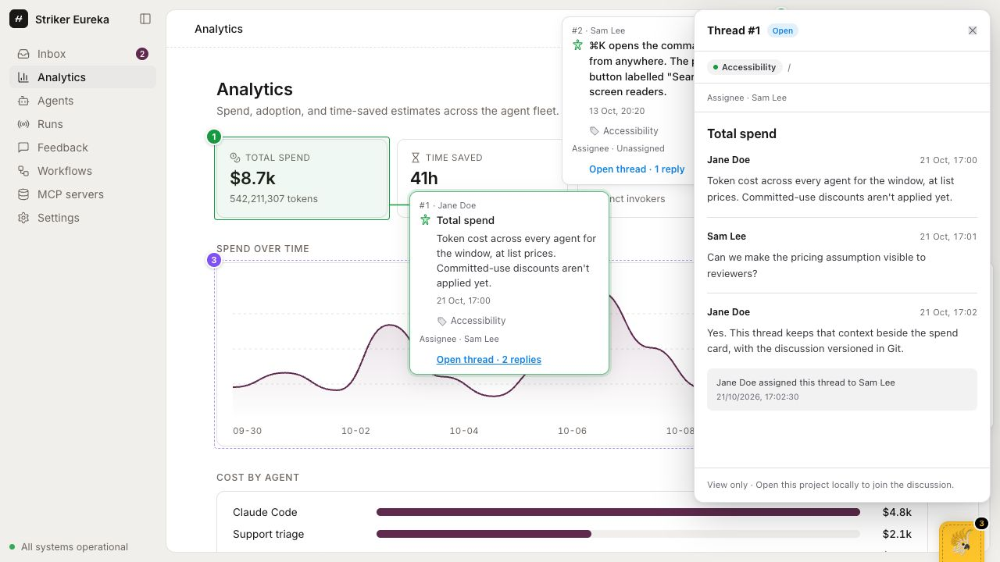
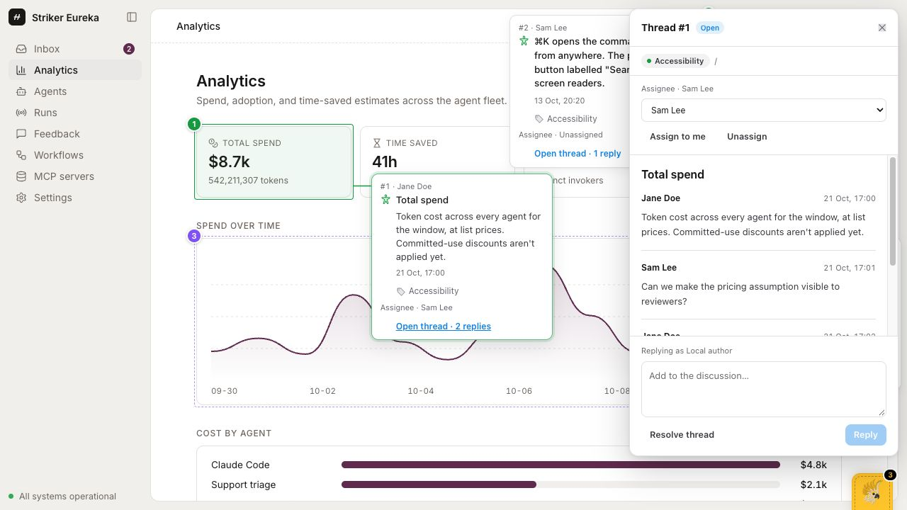

# Discuss a prototype with your team

Annotoo keeps comments beside the interface and stores their discussions in Git. Use the
Vite plugin for this workflow. There is no separate Annotoo backend or account.

## 1. Set up your prototype

Follow the [framework examples](../README.md#one-package-any-framework). Install
`@staplelab/annotoo` and add its included Vite integration:

```ts
import { defineConfig } from 'vite';
import annotoo from '@staplelab/annotoo/vite';

export default defineConfig({
  plugins: [annotoo()], // keep your existing framework plugins too
});
```

The widget starts automatically in development and saves threads in `.annotoo.comments/`.
Production builds exclude the widget and thread data by default. No browser `mount()`
call or empty annotation file is needed. Existing legacy files stay supported.

In your local clone, check the identity Git will use:

```bash
git config user.name
git config user.email
```

Both values are required before Annotoo writes Git-backed comments. If either is absent,
set your own values for this repository:

```bash
git config user.name "Your Name"
git config user.email "you@example.com"
```

The displayed author name comes from `user.name`. Annotoo hashes the configured email to
derive a stable author ID; it does not publish or store the raw email in thread files.
These local settings provide attribution, not verified identity or access control.
Repository permissions still come from your Git host and local filesystem.

Start the prototype's development server as usual.

## 2. Start and follow a discussion

1. Click the cockatoo tab. Annotate turns on.
2. Click an element, choose a category, and write the opening comment. Save with
   **⌘ Enter** on macOS or **Ctrl Enter** on Windows and Linux.
3. Use **Open thread** on a note, or select it from the annotation list, to read its
   discussion and add a reply. The Git name appears with each new contribution.
4. Choose **Resolve thread** when it is addressed. The thread leaves the page's open
   pins, and stays in the **Resolved** or **All** list.
5. Choose **Reopen thread** if more work is needed. The earlier replies and the
   resolve/reopen events remain readable, with their author and time.

Old notes without an author are shown as **Unattributed**. A new reply adds its own
author without inventing an identity for the original note.

Assign the next step to a teammate in the thread, or unassign it when no one owns it.
The opening author, reply authors and assignee are separate: assigning work does not
change who wrote a comment. Assignment events remain in the history. The picker draws from your current Git identity,
authors in local Git history, and participants already stored in threads. Names and
hashed IDs identify them; a raw email directory is not published in the hosted viewer.
The hosted viewer can read the saved assignee but cannot edit it.





## 3. Share through Git

Each thread is a separate JSON file in `.annotoo.comments/` at the Git repository root.
Inside it, each Vite app has a project subfolder. The project is the repo-relative Vite
root; its first 16 SHA-256 hash characters name the subfolder. The project, route and
element anchor locate a thread without mixing apps that share the same route.
Changes to a legacy note are stored there too; Annotoo leaves the original
`src/annotoo.annotations.json` intact. Keep both the legacy file and the comments
directory in Git. Do not add the comments directory to `.gitignore`.

Review and commit your changes using your usual tools, for example:

```bash
git status --short
git diff -- .annotoo.comments
git add .annotoo.comments
git commit -m "Discuss the prototype flow"
git pull
git push
```

Use your team's normal branch and pull-request conventions. Annotoo never runs commit
or push for you.

Browsers connected to the same dev server refresh from its files. Separate clones do
not share a live session: teammates see your comments after you exchange commits and
pull the new files. Pulling changes refreshes the local discussion while the dev server
is running.

## 4. Handle a Git conflict

Separate thread files reduce collisions when people discuss different parts of a
prototype. Concurrent changes to the same thread can still conflict. Annotoo does not
pretend to synchronize those edits across clones.

If Git reports a conflict:

1. Open the conflicted `.annotoo.comments/<project-hash>/<thread-file>.json` file in your
   merge tool.
2. Keep one valid JSON envelope with `"schemaVersion": 1`, its project and the original thread ID.
   Preserve contributions from both sides, including each reply's ID, body, author and
   time. Do the same for resolution events; do not duplicate records with the same ID.
3. Decide whether the thread should currently be open or resolved. Keep `status`,
   `resolvedAt` and `resolvedBy` consistent with that decision while retaining its event
   history. Keep the current assignee and assignment events consistent too. Discuss deletion-versus-reply conflicts with the other contributor before
   choosing whether the thread remains deleted.
4. Remove conflict markers, validate the JSON, then finish the merge with your usual
   Git workflow. Open the thread in the running prototype to verify the result.

Do not replace the whole file with one side merely to clear the conflict if that would
discard another person's reply. The Git history remains available for review.

## 5. Publish a review copy

Set `annotoo({ build: 'viewer' })` in your Vite config, then build and deploy. The plugin
embeds the current merged threads, including replies, assignments and resolution history.
Without this opt-in, production builds contain no Annotoo widget or thread snapshot.

The normal hosted viewer is read-only. It has no Git credentials or shared write
endpoint, and visitors do not need an account to read the discussions. New commits
appear in hosted copies after you rebuild and deploy. An explicit `?annotoo=author`
override on a hosted page creates personal browser-only changes; it does not update Git
or what other visitors see.

**Copy as Markdown** includes attribution, replies and resolution history for sharing
the discussion in a ticket, document or chat.

## Storage details

By default the directory is `.annotoo.comments/` relative to the Git repository root.
If no Git root is found, the Vite root is used. Set another directory with
`annotoo({ commentsDir: 'prototype-comments' })`. Git-backed writing still needs a Git
identity.

Each `<project-hash>/<thread-id>.json` has this shape:

```ts
type ThreadFile = {
  schemaVersion: 1;
  project: string; // repo-relative Vite root, e.g. 'examples/vite-react' or '.'
  thread: Annotation;
  deleted?: true;
};
```

Filename-safe thread IDs are used directly. Legacy IDs containing unsafe filename
characters keep their original ID inside the thread and use
`legacy-<sha256-of-id>.json` as the filename.

A deleted thread keeps a `deleted: true` record so a legacy note is not accidentally
restored on the next load. A resolved thread is retained as a discussion and is not a
deletion. All new fields on `Annotation` are optional; see the
[annotation format](https://staple-lab.github.io/annotoo/schema).
